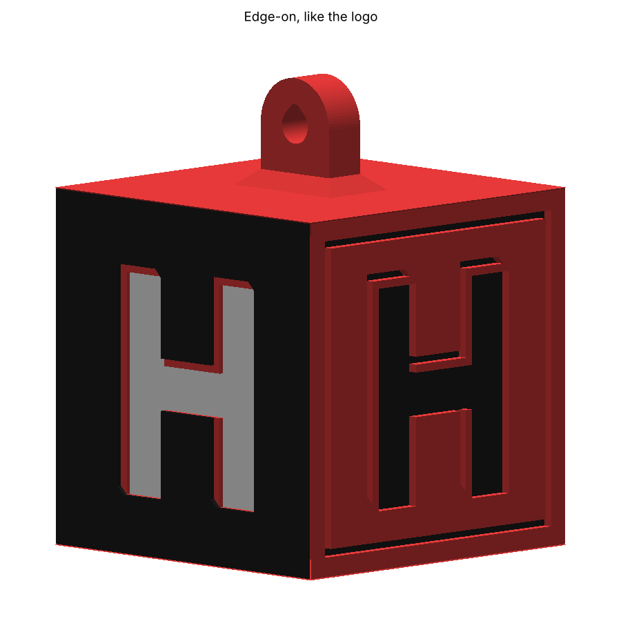
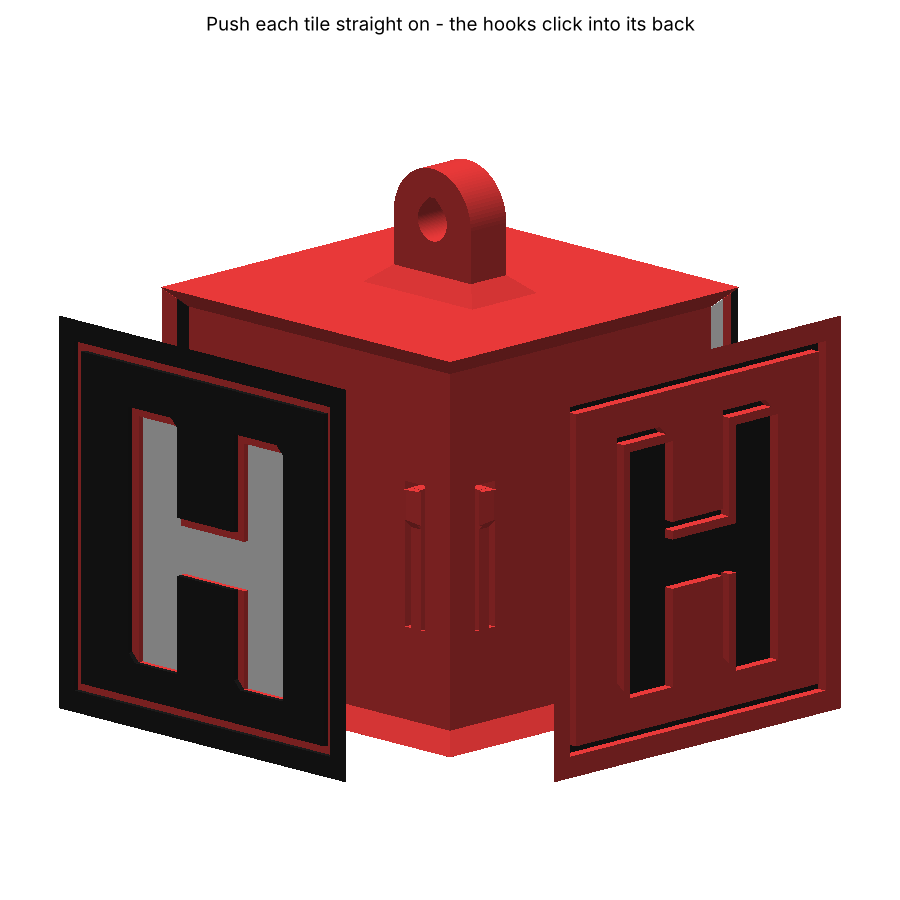
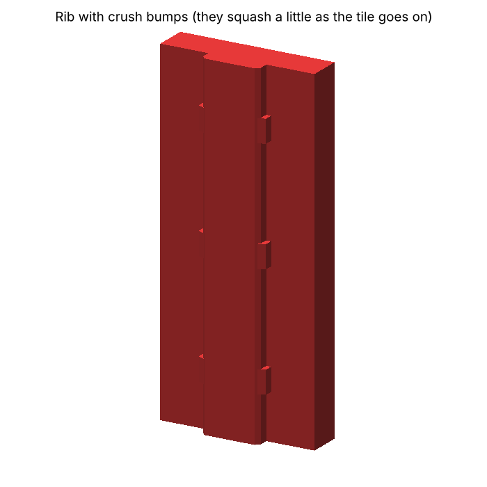
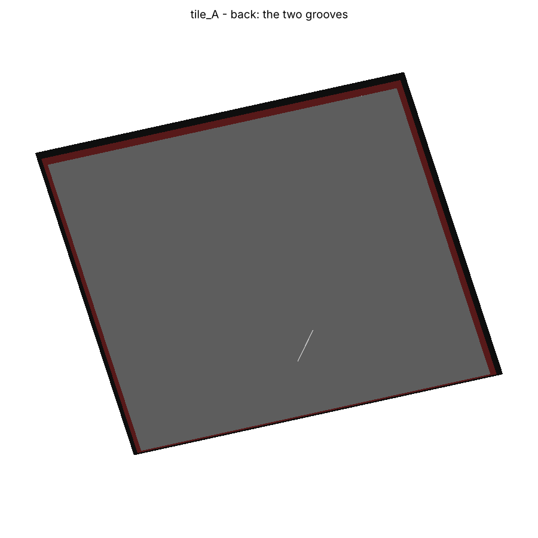
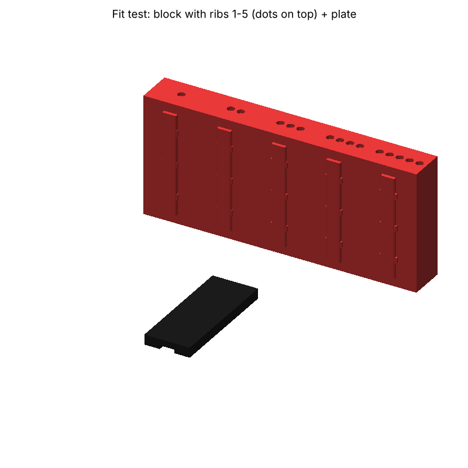

# HH Cube Ornament (v5, LEGO-style press fit, zero glue)




This is a real 45 mm box. Going around it you see black, red, black, red, with a red top and bottom.
The colours meet exactly on the cube edges. **The H is set into each side** like the logo.

## How the tiles hold: LEGO-style grip


- **The parts:** each side of the cube has **two vertical ribs**, and each tile has **two matching straight grooves** in its back.
  Press a tile straight on and the grooves grip the ribs, the way LEGO bricks grip each other.
- **The bumps:** small **crush bumps** on the ribs squash a little as the tile goes on.
  This is the standard trick for making printed press-fits forgiving, because it keeps the grip consistent even if the printer is a bit off.
- **Accuracy:** the width that matters (across the rib and across the groove) is printed in the printer's **most accurate direction on both parts**.
- **One way up:** the ribs are 1 mm off-centre, so a tile only goes on the right way up. The arrow on the back of each tile points up, towards the loop.
- **Removable:** you can pull a tile off and press it back on.

 

## Step 1: print the fit test (about 10 min, red only)
Every printer prints press-fits a little differently, so you find the right tightness for **your** printer first.



1. Open **`fit_test.3mf`** and print it. It's a block with **5 ribs, numbered by the dots on top (1 to 5)**, plus a small test plate.
   Use **0.20 mm layers**, the same as the real print.
2. Press the plate, groove side down, onto **rib 1**, then rib 2, and so on.
3. Pick the **lowest number that feels like LEGO**: it goes on with a firm push and won't fall off when you shake it.
   - Too easy, or it falls off? Try a higher number.
   - Too hard to push on? Use a lower number.

| Fit | Grip per side | Feels like |
|---|---|---|
| 1 | 0.05 mm | looser |
| 2 | 0.10 mm | |
| 3 | 0.15 mm | middle |
| 4 | 0.20 mm | |
| 5 | 0.25 mm | tighter |

The test isn't a rough guess. `build.py` checks that pressing the plate onto test rib N squashes each bump
**exactly** as much as a real tile does on `HH_Cube_fitN`.

## Step 2: print the ornament
Open **`HH_Cube_fit<your number>.3mf`**. All five parts are on one plate, with filaments **1 = red, 2 = black, 3 = white**.
Set all three to PLA. Use 0.20 mm layers with a 0.20 mm first layer, no supports, and leave elephant-foot compensation at its default.
If Bambu Studio says *"The 3mf is not from Bambu Lab…"*, that's expected.

**Without an AMS:** print `core_fitN.stl` in red. For `tile_A.stl`, start with white, then change to red at layer 6 (1.20 mm) and to black at layer 9 (1.80 mm).
For `tile_B.stl`, start with black and change to red at layer 6 (1.20 mm).

## Step 3: put it together
Go around the cube A, B, A, B. Line each tile up square to its side with the arrow pointing up, and press it straight on.

## Parts

| File | Qty | What |
|---|---|---|
| `fit_test.stl` + `fit_test_plate.stl` | 1 each | the fit test (red) |
| `core_fit1.stl` … `core_fit5.stl` | 1 | the red cube, one per fit level |
| `tile_A.stl` | 2 | **white** 0–1.0, then **red** 1.0–1.6, then **black** 1.6–2.2 |
| `tile_B.stl` | 2 | **black** 0–1.0, then **red** 1.0–2.2 |

## What `build.py` checks before it writes anything
- **Clean geometry:** every part is watertight, one body, flat on the bed, and still watertight after a float32 save and reload (what a slicer reads).
  The only through-hole in the cube is the hanging loop.
- **Colours:** the colour regions don't overlap, and every colour change falls exactly on a layer boundary.
- **Printable sizes:** every tile layer is free of features and gaps narrower than 0.8 mm.
- **No see-through spots:** the top floor layer is unbroken over the grooves and under every recess.
- **The fit, checked without the bumps:**
  - each tile pushes straight on without touching the cube or its neighbours;
  - it can't shift sideways more than 0.10 mm;
  - it won't go on upside down.
- **The fit, checked with the bumps:** the only overlap between a tile and the cube is the planned squash of the bumps, matched to the computed volume within 1 %.
- **The fit test matches the cube:** it squashes each bump exactly as much as the real cube does at the same fit number.
- **The shape:** the outer surfaces form a true 45 mm cube.

```bash
pip install trimesh manifold3d numpy matplotlib pillow scipy
python3 build.py && python3 render.py && python3 build_3mf.py
```
