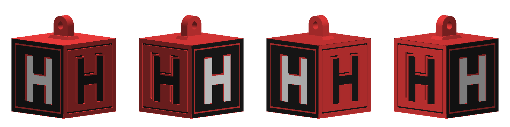
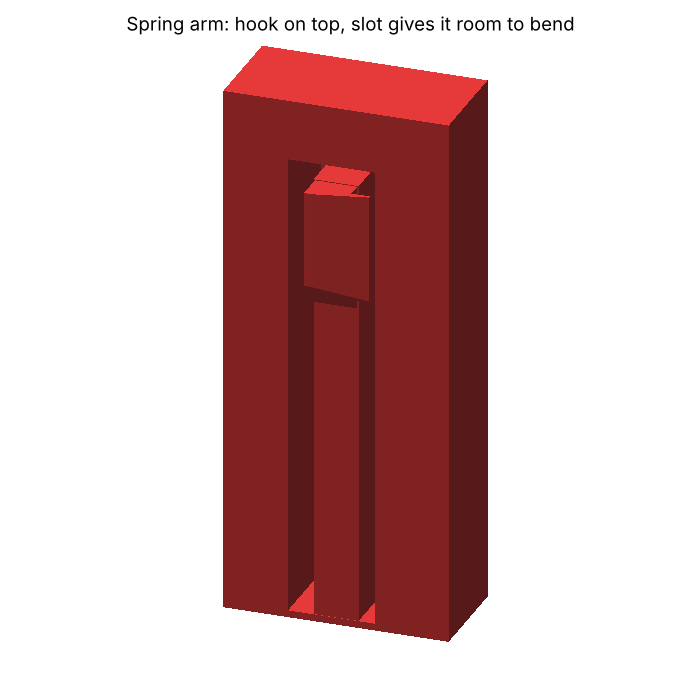

# HH Cube Ornament (v4, snap-fit, zero glue)




This is a real 45 mm box. Going around it you see black, red, black, red, with a red top and bottom.
The colours meet exactly on the cube edges. **The H is set into each side** like the logo.


## The tiles click on
No glue, no lid, no loose parts. The cube is one red piece, and each H tile snaps onto it.


- **On the cube:** every side has **two spring arms**. Each arm is a strip of plastic set into a slot,
  attached at the bottom and free at the top, with a small hook that sticks out about 1 mm.
- **On the tile:** the back of every tile has **two matching pockets**. Each one has a narrow mouth
  (the first two printed layers form a lip) with a wider space behind it.
- **Clicking it on:** hold a tile square to its side and **push it straight on**. The edge of each pocket rides up the
  hook's ramp and bends the arm sideways by 0.6 mm. Once the hook passes the lip, the arm springs back
  under it. That's the **click**. The tile is now locked and can move less than 0.2 mm.
- **It only fits one way up.** Both catches sit above the centre of the side, so a tile held upside down won't
  seat. The arrow on the back of each tile points **up** (towards the hanging tab). Go around the cube A, B, A, B.
- **It's meant to stay on.** The hook's catch face is flat, so a clicked-on tile stays put for good.

 

## Parts

| File | Qty | Colours, bottom to top (Z) |
|---|---|---|
| `core.stl` | 1 | Red |
| `tile_A.stl` | 2 | **White** 0–1.0, then **red** 1.0–1.6, then **black** 1.6–2.2 |
| `tile_B.stl` | 2 | **Black** 0–1.0, then **red** 1.0–2.2 |

## Printing: `HH_Cube_Ornament.3mf` (AMS)
Open it in Bambu Studio. All five parts are on one plate, with filaments **1 = red, 2 = black, 3 = white**.
Use **0.20 mm layers with a 0.20 mm first layer.** The lip and the colour heights are designed for exactly that.
You don't need supports: every overhang is 45° or less, and the slot ceilings are short bridges.

- **Keep elephant-foot compensation on** (Bambu's default is 0.15 mm). The pocket mouth is in the first two layers,
  so a squashed first layer would make it tight.
- If Bambu Studio says *"The 3mf is not from Bambu Lab…"*, that's expected. Your own printer and filament settings are used.

Without an AMS: print `core.stl` in red. For `tile_A.stl`, start with white, then change to red at layer 6 (1.20 mm) and to black at layer 9 (1.80 mm).
For `tile_B.stl`, start with black and change to red at layer 6 (1.20 mm).

## If the click needs tuning
All the dimensions are parameters at the top of `build.py`:

| Parameter | Default | Change it if |
|---|---|---|
| `SNAP_CLR` | 0.15 | Tiles are hard to push on (raise it to 0.2) or rattle once on (lower it to 0.1) |
| `HOOK` | 0.6 | You want a stronger hold (raise it to 0.7) or a softer click (lower it to 0.5) |
| `BEAM_T` | 1.6 | You want a stiffer click (1.8; strain stays under 0.9 %) |

```bash
pip install trimesh manifold3d numpy matplotlib pillow scipy
python3 build.py && python3 render.py && python3 build_3mf.py
```

## What `build.py` checks before it writes anything
- **Clean geometry:** every part is watertight, one body, flat on the bed, and still watertight after a float32 save and reload (what a slicer reads).
  The only through-hole in the core is the tab's hole.
- **Colours:** the colour regions don't overlap, and every colour change falls exactly on a layer boundary.
- **Printable sizes:** every tile layer is free of features and gaps narrower than 0.8 mm. In the core, the arms are at least 0.8 mm thick and every slot gap is at least 0.6 mm.
  The slots of neighbouring sides never run into each other.
- **No see-through spots:** there are no holes through any tile, and there is 1.0 mm of solid tile over every pocket.
- **The click itself:**
  - with the arms bent, each tile pushes straight on without hitting the cube or its neighbours;
  - with the arms relaxed, the hooks block the way in, so they have to snap past the lip;
  - a seated tile can't be pulled off;
  - an upside-down tile can't seat.
- **The arms won't crack:** bending one stresses the plastic to 0.76 %, against a safe limit of about 1.5 % for PLA, even across layers.
  Each arm needs about 2 N to bend.
- **The shape:** the outer surfaces form a true 45 mm cube.
