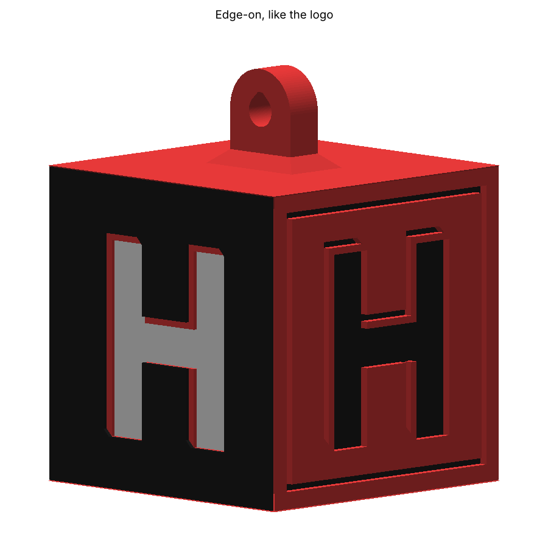
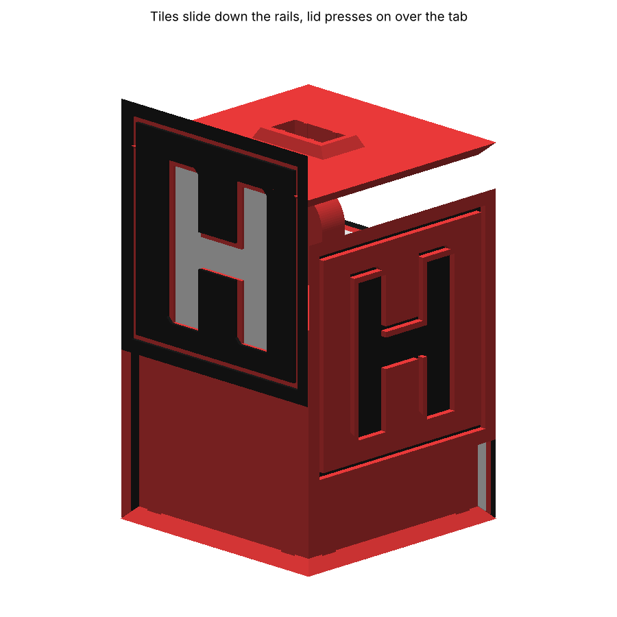

# HH Cube Ornament (v3, no glue)




This is a real 45 mm box. Going around it you see black, red, black, red, with a red top and bottom.
The colours meet exactly on the cube edges. **The H is set into each side** like the logo:
the H is the floor of a pocket, and the pocket wall shows up-and-left of every stroke.


## No glue



1. Each tile has two wedge-shaped (dovetail) grooves on its back. It **slides down** onto matching
   rails on the core until it sits on the bottom edge. Once it's on, it can't come off outward or sideways.
2. Slide all four on, going around **A, B, A, B**. The engraved arrow on the back of each tile points **up**.
3. **Press the lid down** over the hanging tab. Small ribs in its slot grip the tab, and the lid
   stops the tiles from sliding back up.
4. Hang it by the tab. The tab is part of the core, so the lid and tiles carry no weight. To take it apart,
   pull the lid off and slide the tiles up.

## Parts

| File | Qty | Colours, bottom to top (Z) |
|---|---|---|
| `core.stl` | 1 | Red |
| `lid.stl` | 1 | Red |
| `tile_A.stl` | 2 | **White** 0–1.0, then **red** 1.0–1.6, then **black** 1.6–2.2 |
| `tile_B.stl` | 2 | **Black** 0–1.0, then **red** 1.0–2.2 |

## Quickest route: `HH_Cube_Ornament.3mf` (AMS)
Open it in Bambu Studio. All six parts are on one plate, and every colour part already has its filament set:
**filament 1 = red, 2 = black, 3 = white.** Slice it and map the filaments to your AMS slots when you send the job.

Bambu Studio will say *"The 3mf is not from Bambu Lab, load geometry data and color data only."*
That's expected. The file carries only the shapes and colours, and your own printer, filament and
process settings are used. Saving the project once from Bambu Studio makes the message go away.

## Without an AMS (manual filament swaps)
Use **0.20 mm layers with a 0.20 mm first layer.** The colour heights are designed for that.
- `core.stl` and `lid.stl`: red, printed as they load. **No supports needed.** Every overhang is 45°.
- `tile_A.stl` ×2: start with white. Add a pause or filament change on the layer at **1.20 mm** (layer 6),
  switch to red, then another on the layer at **1.80 mm** (layer 9) and switch to black.
- `tile_B.stl` ×2: start with black. Add a pause or filament change on the layer at **1.20 mm** (layer 6) and switch to red.
- Check the layer preview before printing.

Finished size: 45 × 45 × 59 mm. Expect about 40 g.

## If the fit needs adjusting
All the dimensions are parameters at the top of `build.py`:

| Parameter | Default | Change it if |
|---|---|---|
| `RAIL_CLR` | 0.20 | Tiles are too stiff to slide on (raise it) or wobble (lower it) |
| `RIB_H` | 0.25 | The lid is too tight (lower it) or too loose (raise it). This is the rib height; it bites 0.15 into the tab. |
| `GAP` | 0.15 | Tiles touch each other at the corners |

```bash
pip install trimesh manifold3d numpy matplotlib pillow
python3 build.py && python3 render.py && python3 build_3mf.py
```

`build.py` refuses to write the files unless every check passes (the results are in `preview/report.json`):
- every part is watertight, one body, and sits flat on the bed
- the colour regions don't overlap, and each one lies exactly between its layer heights
- every layer of every tile is free of features and gaps narrower than 0.8 mm
- no tile has a see-through hole: the top floor layer is unbroken under every recess, line and groove
- in the assembled cube, nothing collides
- the tiles slide down their rails with no collision, and once on, can't move outward or sideways
- the lid goes straight on and traps all four tiles
- the outer surfaces form a true 45 mm cube
