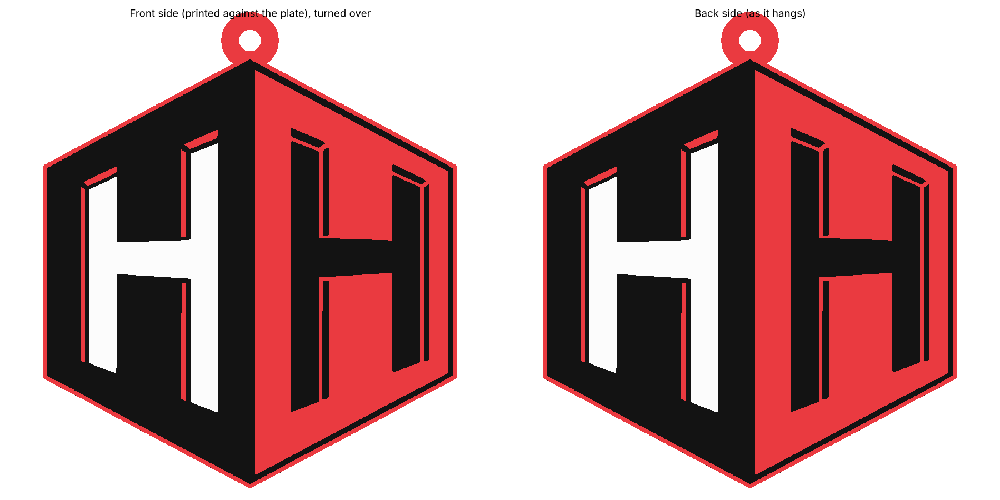

# HH Shield Ornament

A flat, **double-sided** ornament that is an exact copy of the logo, traced directly from the
logo file (`logo_source.webp`) rather than redrawn.


*Left: the original logo. Right: the traced print artwork.*



- **Size:** 86 × 90 mm for the logo, plus a red loop at the top point (99.5 mm tall in total). It's 3 mm thick and weighs about 22 g.
- **Both faces carry the logo.** Ornaments spin on the branch, so either side can face you, and both read correctly.
- **Colour runs through the edge.** The middle of the plate is red, so the edge looks like the logo's red outline.

## Print it (Bambu Lab P2S + AMS)
Open **`HH_Shield_Ornament.3mf`** in Bambu Studio. The filaments are set up as
**1 = red, 2 = black, 3 = white**. It's already lying face down, centred on the plate.

- **Plate:** the textured PEI plate gives the front face a crisp, even texture.
- **Layers:** 0.20 mm layers with a 0.20 mm first layer. The colour heights are designed for exactly that.
- **No supports, no brim.**
- **Bed adhesion matters:** the front face is printed directly on the bed, so a clean plate (dish soap and water) is worth it.
- **Optional:** ironing on the top surface gives the back side a smooth finish.
- **Colour swaps:** colours appear side by side only in the first 3 layers and the last 3 layers. In between, the plate is all red. That keeps colour swaps to roughly 15.

| Z (mm) | What prints |
|---|---|
| 0.0–0.6 | front logo (mirrored in the file, so it reads correctly once you flip it) |
| 0.6–2.4 | solid red core |
| 2.4–3.0 | back logo |

If Bambu Studio says *"The 3mf is not from Bambu Lab, load geometry data and color data only"*, that's expected.
It means your own printer and filament settings are used.

## What was changed from the logo, and why
The interior artwork is traced exactly. Only two things differ:
1. **The outer red outline is 0.3 mm wider.** In the logo it's only about 0.55 mm wide at this size, which is too thin
   to print reliably. The extra width is added *outside* the edge, so nothing inside moves.
2. **A red hanging loop** is added at the top point. Its 4.5 mm hole stays clear of the artwork.

## Checks (`build_shield.py` refuses to write files if any fail)
- **Fidelity to the logo:** 99.9 % of logo pixels match the source away from the colour edges. The rest are the source image's own blurred, one-pixel-wide colour edges.
- **Printable sizes:** under 0.2 % of any colour lies in features thinner than 0.6 mm.
- **Clean colour parts:** the parts don't overlap, every layer is 100 % covered, and there are no corner-to-corner pinch points or zero-width spikes.
- **One solid plate:** a single body whose only hole is the loop.
- **Survives the slicer:** every part is still watertight after being saved at 32-bit float precision and reloaded, which is how a slicer reads the file.

Regenerate:
```bash
pip install trimesh manifold3d numpy opencv-python-headless pillow scipy matplotlib
python3 build_shield.py && python3 preview_shield.py && python3 build_shield_3mf.py
```
Change `HEIGHT` at the top of `build_shield.py` to resize the ornament. Below about 80 mm, more lines fall under 0.6 mm and the check will stop you.
